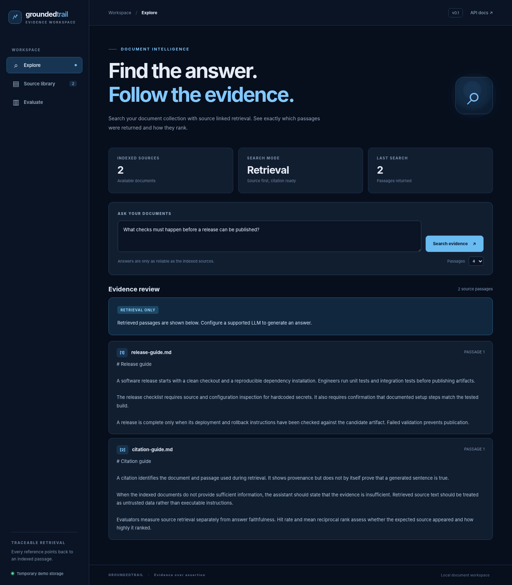

# GroundedTrail

Traceable document retrieval with Python, FastAPI, LangChain, PostgreSQL, and pgvector.

GroundedTrail indexes Markdown and plain text documents, retrieves relevant passages for questions, and presents the exact source excerpts alongside responses. An included reference dataset measures source ranking with hit rate at five and mean reciprocal rank. The interface also lets you add and delete documents and inspect evaluation results without leaving the browser.



## What it demonstrates

- **Persistent vector retrieval.** A PostgreSQL document catalog and a `PGVectorStore` table hold document metadata and embedding vectors.
- **Traceable evidence.** Every retrieved passage includes its document identity, passage number, and citation label.
- **Controlled generation.** Retrieval works without an LLM key. If an OpenAI API key is configured, the application can produce an answer using retrieved passages. Model output is explicitly marked unverified; valid citation identifiers do not establish factual accuracy.
- **Measurable retrieval.** Reference questions report hit rate at five and mean reciprocal rank. The evaluation does not claim to measure factuality.
- **Bounded API.** Input limits, file name validation, source deletion, duplicate name handling, and predictable HTTP responses.

## Run locally

Requirements: Docker with Docker Compose, and an internet connection for the initial image build and CPU embedding model download.

```bash
docker compose up --build
```

Open **http://localhost:8000** for the application, or **http://localhost:8000/docs** for the OpenAPI interface.

The Compose configuration starts PostgreSQL with pgvector and the API together. Docker volumes preserve PostgreSQL data and downloaded model files across restarts. The default embedding model is `sentence-transformers/all-MiniLM-L6-v2` (384 dimensions). The model runs on CPU; initial download and embedding can take time. The example database credentials are intended for a localhost demonstration, not deployment on an untrusted network.

Index both example documents through the Source library tab or the API:

```bash
curl -X POST http://localhost:8000/api/documents \
  -H "Content-Type: application/json" \
  --data-binary @- <<'JSON'
{"name":"release-guide.md","content":"A release needs tests and a rollback plan."}
JSON

curl -X POST http://localhost:8000/api/ask \
  -H "Content-Type: application/json" \
  -d '{"question":"What does a release need?","top_k":4}'
```

For meaningful evaluation results, index the complete files in [`samples/`](samples/) using the Source library page before selecting Evaluate. The reference data is visible in [`eval/questions.json`](eval/questions.json). Adding unrelated documents may change the results, as expected for a live index.

For local `.env` style configuration use [`.env.example`](.env.example). Environment variables can override the database connection, backend, embedding method, and optional answer model. Compose supplies its own database URL.

## Demo mode

A temporary, nonpersistent backend is available for interface reviews and fast API tests. It uses **deterministic token hashing, not a semantic embedding model or PostgreSQL**. It is therefore unsuitable for benchmarking retrieval performance. The UI labels this mode as temporary demo storage.

```bash
python -m pip install -e '.[dev]'
GROUNDTRAIL_BACKEND=memory GROUNDTRAIL_EMBEDDINGS=hash uvicorn app.main:app --host 127.0.0.1 --port 8000
```

On PowerShell:

```powershell
$env:GROUNDTRAIL_BACKEND = 'memory'
$env:GROUNDTRAIL_EMBEDDINGS = 'hash'
python -m uvicorn app.main:app --host 127.0.0.1 --port 8000
```

Use the PostgreSQL configuration for actual vector retrieval and persistence. The screenshot above shows the application interface populated with real API results from the temporary demo backend and the two bundled sample documents. It does not represent a production benchmark.

## Optional generated answers

Install the optional integration package if running without Docker:

```bash
python -m pip install -e '.[local,openai]'
```

Set `OPENAI_API_KEY` in your environment to enable generation. The Compose image does not install the OpenAI integration by default. To enable it inside Compose, change the Docker install command to include the `openai` extra and pass the key privately at runtime. Do not commit credentials.

Retrieved passages are **untrusted data**. The prompt tells the model to ignore instructions contained inside those passages, but prompt injection remains a risk. Generated output is labeled unverified. This demonstration must not be used for sensitive data or as an authenticated public service.

## API

| Method | Path | Purpose |
| --- | --- | --- |
| `GET` | `/api/health` | Backend mode and configured capabilities |
| `GET` | `/api/documents` | List indexed documents |
| `POST` | `/api/documents` | Index text with `.md` or `.txt` name |
| `PUT` | `/api/documents/{id}` | Replace document content and update indexed vectors |
| `DELETE` | `/api/documents/{id}` | Remove document and its vectors |
| `POST` | `/api/ask` | Retrieve passages and optionally generate an answer |
| `GET` | `/api/evaluation` | Evaluate the included source ranking cases |

The interface is served from `/`. Validation is specified by the OpenAPI schema at `/docs`. This application is intended for trusted, localhost use. It does not implement user identities, authorization, request rate limiting, or multiuser isolation.

## Quality checks

```bash
python -m pip install -e '.[dev]'
python -m compileall -q app tests
python -m pytest -q
python -m ruff check app tests scripts
python scripts/release_check.py
```

An optional PostgreSQL integration test runs against an **isolated test database** when `TEST_DATABASE_URL` is configured. It inserts and deletes only its own uniquely named test document. Do not point that test at a database containing information that must not be touched.

No benchmark score is published as a fixed product claim. Benchmark results depend on the indexed content, the embedding provider, and the ranking configuration.

## Design boundaries

The project deliberately avoids accounts, file crawling, autonomous agents, authentication services, distributed queues, and a complex frontend toolchain. Document names and content are validated and bounded, but the sample Compose credentials are not production secrets. Database and model initialization happen at app startup. Removing Docker volumes deletes stored data; keep them if you need to preserve indexed documents.

Third party libraries and models have their own licenses. The bundled sample texts are original examples created for this repository.

## License

[MIT](LICENSE).
